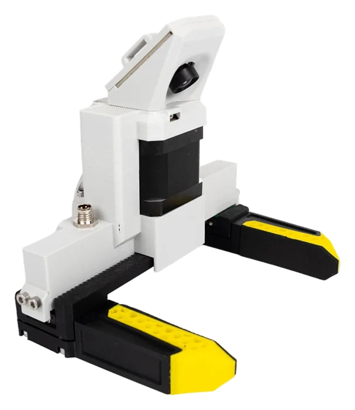
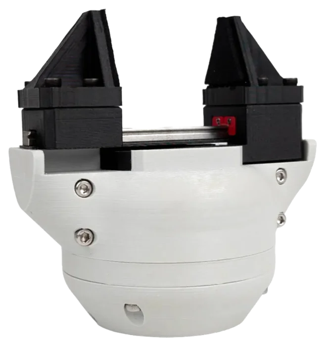
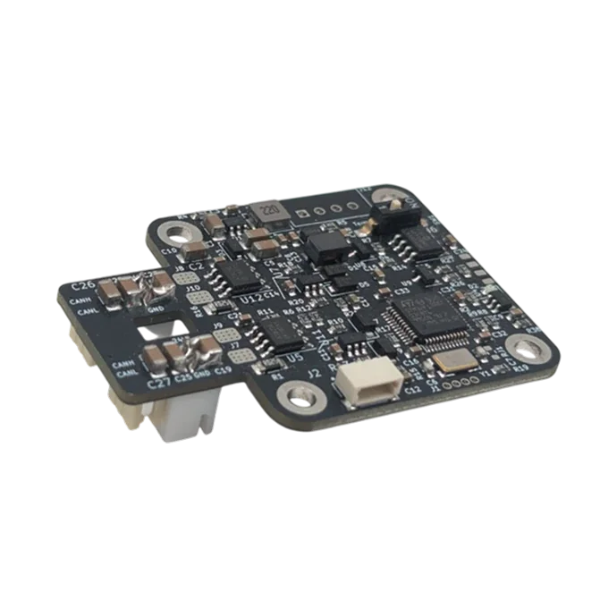
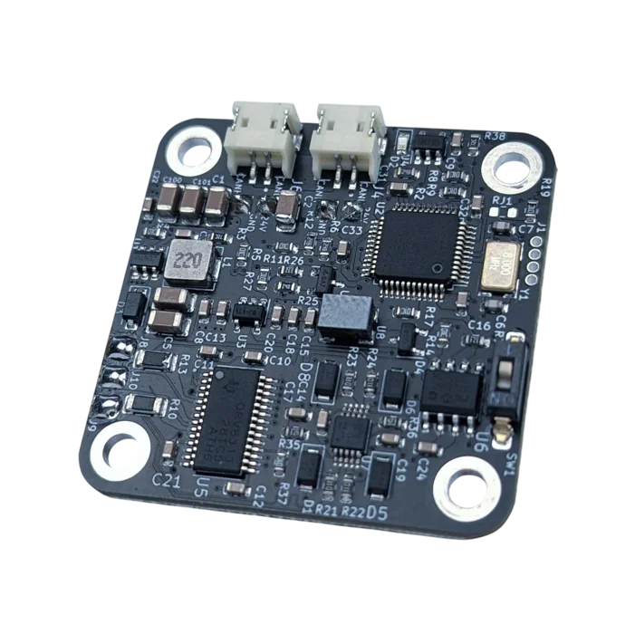

---
hide:
  - navigation
  - toc
---

# Source Robotics documentation

Manuals and guides for the open-source robot arms, grippers and motor controllers by
[Source Robotics](https://source-robotics.com). Each product has its own site, with its own search, its own
versions and comments under every page. This page is the front door.

## Robot arms

-   { .product-photo }

    **PAROL6** <small class="product-updated"><!-- updated: PAROL-docs --></small>

    ---

    The 3D-printed desktop robot arm: the robot manual, the control board, the end effectors, the GUIs,
    programming with the Python API and ROS 2, and the build guide from the printed parts to the first run.

    [:octicons-arrow-right-24: PAROL6 documentation](https://docs.source-robotics.com/PAROL-docs/)

-   :material-robot-industrial:{ .lg .middle } **PAR6**

    ---

    The collaborative robot arm for education, research and AI: the arm, the Robot Control Box, programming and the
    real-time interface.

    :material-clock-outline: Coming soon

## Grippers

-   { .product-photo }

    **MSG gripper** <small class="product-updated"><!-- updated: MSG-gripper-docs --></small>

    ---

    The compliant stepper gripper on the STEPFOC driver: three stepper sizes, three strokes up to 155 mm,
    force and position control over CAN, open source from the printed body to the firmware.

    [:octicons-arrow-right-24: MSG documentation](https://docs.source-robotics.com/MSG-gripper-docs/)

-   { .product-photo }

    **SSG-48 gripper** <small class="product-updated"><!-- updated: SSG48-gripper-docs --></small>

    ---

    The adaptive electric gripper on the Spectral Micro driver: 48 mm stroke, fin-ray or solid fingers, force
    feedback, a 3D configurator to try the fingers and the colours.

    [:octicons-arrow-right-24: SSG-48 documentation](https://docs.source-robotics.com/SSG48-gripper-docs/)

## Motor controllers

-   { .product-photo }

    **STEPFOC** <small class="product-updated"><!-- updated: STEPFOC-docs --></small>

    ---

    Field-oriented control for stepper motors on the back of a NEMA 17: position, speed, torque and impedance
    modes, CAN and UART, Motor GUI in the browser, a Python library.

    [:octicons-arrow-right-24: STEPFOC documentation](https://docs.source-robotics.com/STEPFOC-docs/)

-   { .product-photo }

    **Spectral Micro** <small class="product-updated"><!-- updated: Spectral-BLDC-docs --></small>

    ---

    The compact field-oriented controller for brushless and gimbal motors: STEPFOC's sister, with similar hardware
    and firmware and practically the same commands and tools.

    [:octicons-arrow-right-24: Spectral Micro documentation](https://docs.source-robotics.com/Spectral-BLDC-docs/)

## What's new

The latest releases of the products, from their repositories on GitHub:

<!-- releases -->

Each site's release notes say what changed in the firmware or the product, and the version selector in each
site's header switches between the releases it documents.

## Help, comments and source code

- **Comments:** every page of every site ends with a comments box. The threads live in the
  [Discussions of this repository](https://github.com/Source-Robotics/source-robotics.github.io/discussions),
  one per page, and a GitHub account is all it takes to write.
- **Questions and discussion:** the [Source Robotics Discord](https://discord.gg/prjUvjmGpZ) and the
  [forum](https://discourse.source-robotics.com/).
- **A mistake in a manual:** every page has a link to edit it on GitHub or to report the problem.
- **Hardware designs, firmware and software:** [github.com/Source-Robotics](https://github.com/Source-Robotics).
- **For AI tools:** every page of every site is also served as Markdown, and each site publishes an index for
  language models: [PAROL6](https://docs.source-robotics.com/PAROL-docs/latest/llms.txt),
  [MSG](https://docs.source-robotics.com/MSG-gripper-docs/latest/llms.txt),
  [SSG-48](https://docs.source-robotics.com/SSG48-gripper-docs/latest/llms.txt),
  [STEPFOC](https://docs.source-robotics.com/STEPFOC-docs/latest/llms.txt),
  [Spectral Micro](https://docs.source-robotics.com/Spectral-BLDC-docs/latest/llms.txt).
